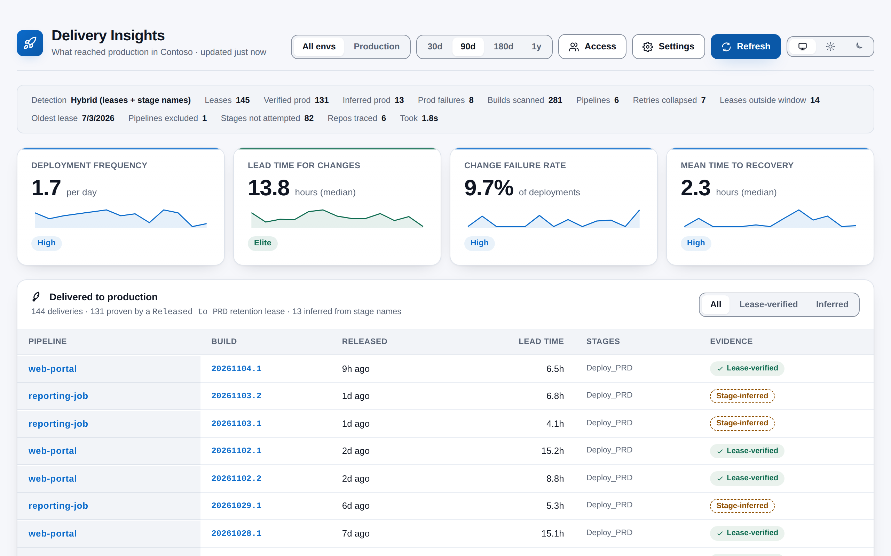
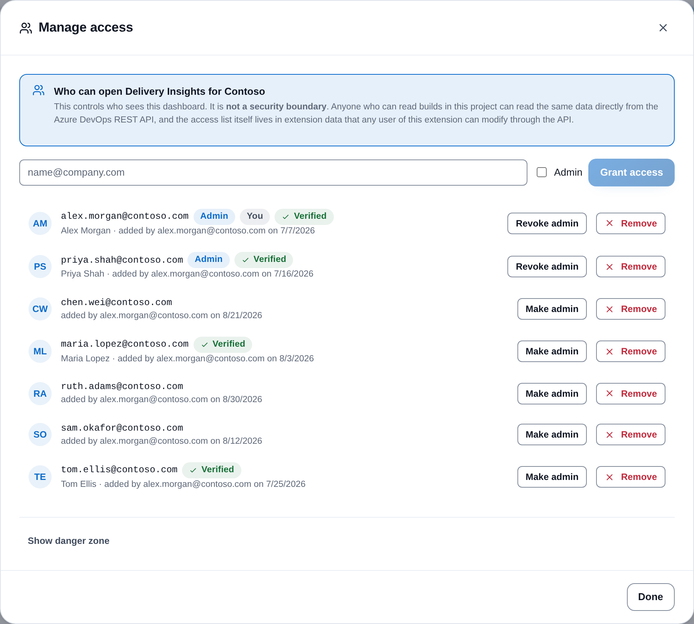
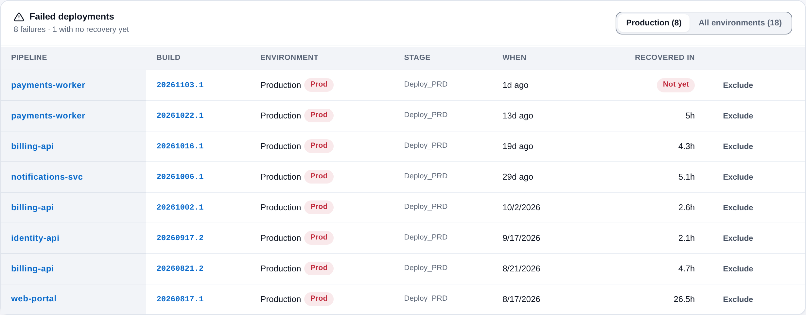
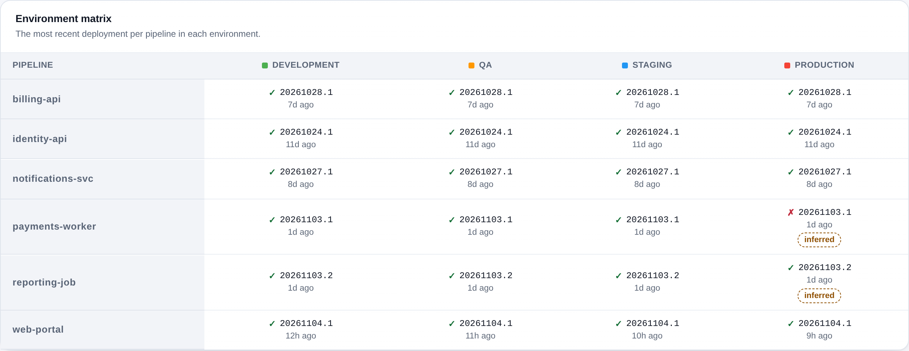
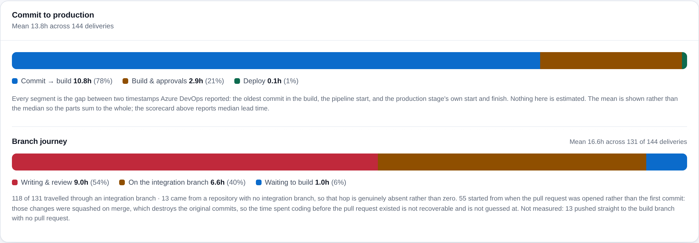

# Delivery Insights

[](https://github.com/adam-wheater/azure-devops-delivery-insights/actions/workflows/ci.yml)

An Azure DevOps extension that shows what actually reached production, what broke on the way, and how your four DORA metrics are trending. It is built for engineering leads, platform teams and anyone asked "how are we delivering?". Everything runs in the browser from a hub under **Pipelines > Delivery Insights**, against your own organization's Azure DevOps REST API.



The distinguishing idea is where "reached production" comes from. Most DORA tools guess it from pipeline stage names. This one reads **build retention leases**: when a pipeline finishes deploying to production it POSTs a lease tagged with a well-known `ownerId` ([snippet below](#the-signal)), and that lease is durable, first-party evidence that a specific build was released. Stage names remain as a fallback, and every row in the UI says which of the two it came from.

## Table of contents

- [Getting started](#getting-started)
- [Features](#features)
- [Screens](#screens)
  - [Access control](#access-control)
  - [Header, progress and messages](#header-progress-and-messages)
  - [Diagnostics strip](#diagnostics-strip)
  - [DORA scorecard](#dora-scorecard)
  - [Delivered to production](#delivered-to-production)
  - [Failed deployments](#failed-deployments)
  - [Weekly trends](#weekly-trends)
  - [Environment matrix](#environment-matrix)
  - [Deployment timeline](#deployment-timeline)
  - [Commit to production](#commit-to-production)
  - [Branch journey](#branch-journey)
  - [The analysis is kept until you re-analyse](#the-analysis-is-kept-until-you-re-analyse)
  - [Settings dialog](#settings-dialog)
- [How it works](#how-it-works)
- [How production is detected](#how-production-is-detected)
  - [The signal](#the-signal)
  - [Why a hybrid is unavoidable](#why-a-hybrid-is-unavoidable)
  - [Three guards against double counting](#three-guards-against-double-counting)
- [DORA metrics](#dora-metrics)
- [Settings](#settings)
- [Detection rules](#detection-rules)
- [Scopes & permissions](#scopes--permissions)
- [Privacy](#privacy)
- [Troubleshooting and known limitations](#troubleshooting-and-known-limitations)
- [Development](#development)
- [Project structure](#project-structure)
- [Tech stack](#tech-stack)
- [Contributing](#contributing)
- [License](#license)

## Getting started

1. Install **Delivery Insights** from the Visual Studio Marketplace (publisher `adam-wheater`, listed with the **Preview** flag): <https://marketplace.visualstudio.com/items?itemName=adam-wheater.delivery-insights>.
2. Add the [retention-lease step](#the-signal) to the end of your production deployment job.
3. Open any project and go to **Pipelines**. The hub appears as **Delivery Insights** in the Pipelines hub group (`ms.vss-build-web.build-release-hub-group`, order 99).
4. **First run:** you see **Set up Delivery Insights**. Click **Claim ownership** to become administrator for this project.
5. Grant access to your team from **Access**.
6. Check in **Settings** that the lease owner id matches what your pipeline writes and that your stage names match an environment (use **Test a stage name**).
7. Click **Analyse** (the empty state also offers **Analyse deployments**). Nothing is scanned until you do, and the last analysis is restored on later visits.

Without step 2 the extension still works in Hybrid mode: every production row is marked *Stage-inferred*.

## Features

- **Lease-verified production deliveries** -- One row per delivered build, with release time, lead time, contributing stages and whether a retention lease or a stage name proved it.
- **Failed deployments** -- Outright failures and deliveries that failed a production attempt before succeeding, with time to recovery per pipeline and environment.
- **DORA scorecard** -- Deployment Frequency, Lead Time for Changes, Change Failure Rate and Mean Time to Recovery with Elite/High/Medium/Low bands and a weekly sparkline per card.
- **Commit to production and branch journey** -- A measured split of commit to production (waiting, build and approvals, deploy), and of the waiting part by branch (writing and review, integration branch, waiting to build).
- **Diagnostics strip** -- Detection mode, lease count, verified vs inferred production, failures, retries collapsed, leases outside the window, oldest lease and scan duration.
- **Environment matrix, timeline and weekly trends** -- Latest deployment per pipeline per environment, a binned timeline across environment lanes, and four weekly trend charts.
- **Pipeline exclusion** -- Remove a pipeline from the analysis by definition id, from Settings or straight from a failure row.
- **Cancellable scans** -- **Stop** drains the request queue so no further work starts; requests already in flight finish in the background, and the UI says so.
- **Analysis cached per project** -- The last analysis is restored on load and kept on screen until you choose to re-analyse, labelled with what has changed since.
- **Settings persisted per project** -- Stored in the Extension Data Service under a project-specific document id.
- **Access list** -- The first person to claim the dashboard becomes administrator and grants access by email; stated in the UI as a UX gate, not a security boundary.
- **Theme follows Azure DevOps** -- Light, dark and high-contrast host themes are followed automatically, with a manual Azure DevOps / Light / Dark override.
- **WCAG AA contrast** -- Design-system colour pairs meet 4.5:1 for text and 3:1 for UI in both palettes; status is never conveyed by colour alone.

## Screens

### Access control

#### Gate screens

| State | Screen |
|---|---|
| Checking | A skeleton card ("Checking access…" for screen readers). Re-checking an already granted user keeps the dashboard mounted. |
| No list for this project | **Set up Delivery Insights**: "Nobody has claimed this dashboard for *project* yet." Shows your avatar, display name and sign-in name, a **Claim ownership** button and the disclaimer below. |
| Claim lost to someone else | Error banner: "Someone else claimed this dashboard first. Ask them to add your address to the access list." |
| Not on the list | **You don't have access yet**: your exact sign-in name with a **Copy** button, any alternate address tried ("We also tried: …"), a **Request access** button (a `mailto:` to every administrator with your sign-in name pre-filled), **Check again**, the administrator list, the disclaimer and a *Technical details* disclosure. |
| Check failed | **Couldn't check access** with the classified message, **Try again**, and *Technical details* with a copy button. A failure never reads as "unclaimed". |

**This is a UX gate, not a security boundary.** The product says so on the claim screen, the locked screen and the admin panel: anyone who can read builds in the project can read the same data from the REST API, and the access list lives in extension data that any user of this extension can modify through the API. If you need real enforcement it has to live behind a server you control.

#### Manage access (admins)



**Access** opens the **Manage access** dialog: the disclaimer, an email field with an **Admin** checkbox and **Grant access** ("Will be stored as *normalised address*" appears when trimming or lower-casing changes it), then one row per entry sorted admins first. Each row shows the address, an **Admin** pill, **You** for yourself, **Verified** once the entry is bound to an account id, and "added by … on …". **Make admin** / **Revoke admin** and **Remove** act immediately, without a confirmation step; both are disabled for the last administrator, and the service refuses the change too. While only one administrator exists, a warning banner asks you to grant admin to a second person. A collapsed **danger zone** offers **Reset access list**, enabled only after typing `RESET`, which replaces the list with you as sole administrator.

Addresses must contain `@` and no whitespace.

#### Matching, and what to do when it goes wrong

The list matches on `SDK.getUser().name`, documented in the SDK as *"Name of the user (email/login)"*: the UPN in AAD-backed organizations, the account email in MSA-backed ones. This needs **no extra OAuth scopes**, which matters: adding one would set `NeedsReauthorization` on every existing install until an organization admin re-approves.

That sign-in name is not guaranteed to equal the directory `mail` attribute. AAD B2B guests are the usual divergence: the resource-tenant UPN is `adam_contoso.com#EXT#@contoso.onmicrosoft.com` while an admin naturally types `adam@contoso.com`. The extension:

- matches against both the raw name and the un-mangled guest address (split on the last underscore);
- prints the exact string Azure DevOps reported on the locked screen, with a copy button;
- binds the immutable account id to the entry on the first successful match, so a later UPN change cannot lock someone out.

#### Ownership races and storage

The claim POSTs a document carrying a random nonce, waits 750 ms, reads it back, and if its own nonce survived waits a further 2 s and confirms again. Both racers converge on the same winner and the loser never overwrites. Edits are read-modify-PATCH with up to three attempts on conflict; transient and denied failures stop immediately. The list is stored as `delivery-insights-acl/acl.<projectId>` at the shared (organization-wide) scope.

### Header, progress and messages

The header is the shared `AppShell`: the title and subtitle ("What reached production in *project*", plus "updated *n* ago" once data is on screen), the **All envs / Production** toggle, the analysis window (30d, 90d, 180d, 1y), **Access** (administrators only), **Settings**, the primary button and the Azure DevOps / Light / Dark theme toggle. The primary button reads **Analyse** before the first run, **Refresh** once data is on screen, **Re-analyse** when settings have changed since the data was produced, and becomes a red **Stop** while an analysis runs. Panels appear top to bottom in the order of the sections below.

While an analysis runs, a progress bar shows the current phase ("Fetching pipelines…", "Fetching builds…", "Scanning build timelines…", "Tracing branch history…") with completed/total counts, and any previous result stays on screen dimmed. Banners above the panels report a failed settings save ("Settings not saved"), stale data ("Showing the previous analysis"), analysis errors ("Analysis problem") and notices (stopped, snapshot trimmed, pipeline excluded). Before the first analysis an empty state reads "Ready when you are" with an **Analyse deployments** button.

### Diagnostics strip

| Item | Meaning | Shown |
|---|---|---|
| Detection | Effective mode: "Hybrid (leases + stage names)", "Leases only" or "Stage names only" | always |
| Leases | Builds with a lease for the configured owner id (tooltip notes the endpoint has no pagination) | always |
| Verified prod | Production records proven by a lease | always |
| Inferred prod | Production successes from a stage name with no lease | when > 0 |
| Prod failures | Failed production records from the timeline | always |
| Builds scanned / Pipelines | Builds and definitions analysed | always |
| Retries collapsed | Stage attempts folded into their latest attempt | when > 0 |
| Leases outside window | Leases whose build was not analysed | when > 0 |
| Oldest lease | Earliest lease date returned; releases before it may have expired | when known |
| Pipelines excluded | Definitions skipped by the exclusion list | when > 0 |
| Stages not attempted | Skipped, cancelled, timed-out or awaiting-approval stages | when > 0 |
| Timeline errors | Timelines that could not be fetched | when > 0 |
| Repos traced / Branch trace errors | Repositories queried for the branch journey, and those whose lookup failed | when > 0 |
| Took | Wall-clock seconds for the analysis | always |
| Lease query failed pill | Warn pill: the lease query failed and the analysis fell back to stage names | when the lease call failed |

### DORA scorecard

Four cards, each with its value and unit, a band pill (**Elite**, **High**, **Medium**, **Low**), a sparkline of the weekly series when there are two or more weeks, and a top accent in the band colour. Each card's accessible name reads "*metric*, *value unit*, *band*". Definitions are under [DORA metrics](#dora-metrics).

### Delivered to production

Rows are production records with status succeeded, newest first by release time (lease `createdOn`, falling back to stage finish), 25 at a time with **Show more (*n* remaining)**. The hint reads "*n* deliveries · *m* proven by a *ownerId* retention lease · *k* inferred from stage names". The **All / Lease-verified / Inferred** filter resets paging.

| Column | Definition |
|---|---|
| Pipeline | Definition name, linking to the pipeline in Azure DevOps |
| Build | Build number, linking to the run's results page |
| Released | Relative time of release; the exact time is in the tooltip |
| Lead time | Release finish minus the oldest commit in the build; a dash when no commit was found; "≈" when commit history was capped (a lower bound) |
| Stages | Every production stage that contributed |
| Evidence | **Lease-verified** (green chip with a check), **Stage-inferred** (amber chip), plus a red **Retried** chip when a production stage failed before delivery |

Empty state: "No production deliveries in this window", with a reminder to check the owner id or widen the window.

### Failed deployments



Rows are records that failed outright, plus succeeded records with a failed production attempt, newest first, 25 at a time. Scope toggles between **Production (*n*)** (default) and **All environments (*n*)**; the hint reads "*n* failures · *k* with no recovery yet".

| Column | Definition |
|---|---|
| Pipeline / Build | As above, with links |
| Environment | Matched environment, with a red **Prod** pill for production |
| Stage | The stage names involved |
| When | Relative finish time |
| Recovered in | For an outright failure: time to the next success **in the same pipeline and environment**, or a red **Not yet** pill. For a retried delivery: a green **Retried & delivered** chip |
| Exclude | Ghost button that removes the pipeline from the analysis immediately (no confirmation); a notice points to Settings to undo it |

Empty state: "Nothing failed".

### Weekly trends

Four small area charts (deployment frequency per day, lead time, change failure rate, MTTR) per ISO week, each with a screen-reader table and a summary label. Needs at least two weeks of production records; otherwise "Not enough history yet".

### Environment matrix



One row per pipeline (sorted by name), one column per included environment in pattern order with its colour swatch. Each cell shows the latest record: a ✓ (green) or ✗ (red) glyph with hidden "Succeeded"/"Failed" text, the build number, relative time and an **inferred** chip for stage-inferred production; a dash when nothing deployed. Empty state: "No deployment data available".

### Deployment timeline

An SVG with one lane per included environment and five date ticks (month and year once the span exceeds 200 days). Deployments within about 9 px of each other in a lane are grouped into one marker with a count badge. A failed group draws a ✕ in the failure colour; a stage-inferred group draws a dashed hollow circle; otherwise a filled circle in the environment colour. Markers are keyboard-focusable with a label such as "payments-api build 20240501.3, Production, succeeded, 4 deployments in this period". A legend explains the three marks. Empty state: "No deployments to plot".

### Commit to production



Every segment is the difference between two timestamps Azure DevOps reported:

```
firstCommit ──preBuild──> buildStart ──pipeline──> deployStart ──deploy──> deployFinish
```

| Segment | Measured from | What it tells you |
|---|---|---|
| **Commit → build** | oldest commit in the build → pipeline run start | code written and sitting unreleased |
| **Build & approvals** | pipeline start → production stage start | build, upstream stages, approval waits |
| **Deploy** | production stage start → finish | the deployment itself |

Only successful production deliveries are counted. Deliveries with no resolvable commit are excluded and the count is shown in the hint. The **mean** is used rather than the median so the parts sum to the total; the scorecard reports median lead time. A lease-proven delivery with no separate pipeline start collapses its build-and-approvals segment to zero, and negative spans (clock skew) are clamped to zero. Empty state: "Nothing measurable yet".

### Branch journey

Shown inside the same card when the branch journey is enabled. It splits the commit → build wait by the branch the change was sitting on:

```
change starts ──code──> merged to develop ──integration──> merged to built branch ──release──> build starts
```

| Segment | Measured from | What it tells you |
|---|---|---|
| **Writing & review** | change start → merged onto the integration branch (or straight onto the built branch) | coding plus pull request review |
| **On the integration branch** | merged to the integration branch → merged to the built branch | how long work sits before a release is cut |
| **Waiting to build** | merged to the built branch → pipeline run start | how long a merged change waits for a run |

The terminal hop is whatever branch the pipeline built (`build.sourceBranch`), not `main`, so release and hotfix pipelines are measured correctly. **Merge strategy matters, and the code accounts for it**: squash, rebase and rebase-merge rewrite the commit SHA, so two queries are used, which pull requests *merged* a commit and which pull request *produced* it. For a squashed change the journey starts from **when the pull request was opened**, and the panel says how many samples that applies to. Only completed pull requests count, and the earliest completion wins.

A repository proven by its refs to have no integration branch reports that hop as **absent**; one that could not be checked reports **unknown** and contributes no sample. The panel has its own denominator ("Mean *x* across *n* of *m* deliveries") and lists untraced deliveries by cause: not hosted in Azure Repos, no commit history, pushed straight to the build branch, lookup failed, or route undetermined.

### The analysis is kept until you re-analyse

Changing a setting saves it and leaves the previous result on screen with a warn banner naming what changed ("the time range changed to 90 days", "production detection changed", "a pipeline was put back into the analysis", "an environment was added back", "environment patterns changed", "the branch journey was switched on", "the integration branch patterns changed"), and the button becomes **Re-analyse**.

Excluding a pipeline and narrowing to production are not flagged, because the tables, matrix and timeline filter the loaded records immediately. The scorecard, weekly trends and commit-to-production card are not recomputed until the next analysis (see [Known limitations](#troubleshooting-and-known-limitations)).

Settings are never overwritten with defaults after a failed read. A failed read is reported as *unavailable*, and saving is blocked with "Your saved settings could not be read, so nothing will be written over them. Reload the page and try again." A failed save is shown in a banner.

### Settings dialog

**Settings** opens a dialog with production detection, the time period, the DORA band thresholds, the excluded pipelines, the branch journey and the environment patterns. **Save settings** saves them but does not start an analysis. Every field, its default and its validation are listed under [Settings](#settings).

## How it works

```
 SDK.init/ready ──> IProjectPageService.getProject() ──> AccessGate (Extension Data: acl.<projectId>)
                                                              │ granted
                                                              v
   App: loadSettings + loadCache (Extension Data) ──> restore last analysis, wait for Analyse
                                                              │ Analyse
                                                              v
 ┌───────────────── fetchDeployments (DeploymentService) ─────────────────────────────────────┐
 │ 1 BuildRestClient.getDefinitions(builtAfter, 500/page, token-drained)   memo 60s           │
 │ 2 BuildRestClient.getBuilds per 100 definitions, 4 batches in parallel, time-sliced        │
 │ 3 BuildRestClient.getRetentionLeasesByOwnerId (one call, parallel with 2)   memo 30s       │
 │ 4 BuildRestClient.getBuildTimeline per build, 12 concurrent ──> ProductionReconciler       │
 │      └─ succeeded prod only: getBuildChanges (≤2×200) + GitRestClient.getCommit            │
 │ 5 Branch journey, 4 repos concurrent: GitRestClient.getPullRequestQuery ×2 per 100 commits │
 │      + GitRestClient.getRefs("heads/") per repository ──> BranchFlowReconciler            │
 └───────────────────────────────────────────────────────────────────────────────────────────┘
                                                              │
                                                              v
   DoraCalculator · computeWeeklyTrends · buildEnvironmentMatrix · computeLeadTimeBreakdown
                                                              │
                                                              v
                       render panels ──> saveCache (Extension Data: analysis.<projectId>)
```

1. **SDK init.** `DeliveryInsightsHub.tsx` installs boot diagnostics (captures the first eight distinct script errors and unhandled rejections), then awaits `SDK.init()` and `SDK.ready()`. If the handshake fails, a plain-text message and a diagnostics block are written into `#root`.
2. **Project context.** `IProjectPageService.getProject()` supplies the project id and name. If no project can be determined, a "Delivery Insights could not start" screen shows the error and diagnostics.
3. **Access check.** `AccessGate` reads the access list (see [Access control](#access-control)). Nothing else mounts until access is granted.
4. **Settings and cache.** `SettingsService.loadSettings` and `loadCache` run in parallel. A cached analysis is restored whatever window it covers; no analysis starts automatically.
5. **Definitions.** On **Analyse**, `getDefinitions` is called with `builtAfter` = now minus the window, 500 per page, ordered by name, draining continuation tokens (hard stop at 50 pages). The result is memoised for 60 seconds per project and window length. Excluded pipelines are dropped here, before any build is fetched.
6. **Builds and leases, in parallel.** Definitions are batched 100 at a time, four batches at once. Each batch calls `getBuilds` for completed builds whose finish time falls in the window, ordered by finish time, 1,000 per request. A full response is treated as possibly truncated, so the window is halved and both halves re-queried, up to 10 times. Builds are then de-duplicated by id. In parallel, unless detection is *stage names only*, one `getRetentionLeasesByOwnerId(project, ownerId)` call fetches every lease with the configured owner id, memoised for 30 seconds.
7. **Timelines.** Up to 12 `getBuildTimeline` calls run at once. Completed `Stage` records are matched to environment patterns; skipped, cancelled, abandoned and manual-queue stages are counted as "not attempted" and ignored. `ProductionReconciler` turns each build into records (see below). For builds with a succeeded production record only, `getBuildChanges` reads up to two pages of 200 changes and `GitRestClient.getCommit` reads the oldest one's committer date.
8. **Branch journey** (if enabled). Production builds from Azure Repos Git are grouped by repository; four repositories at a time get two `getPullRequestQuery` calls per batch of 100 commits (commit type and last-merge-commit type, halving on rejection down to 5) and one `getRefs(repo, project, "heads/")` call to prove whether an integration branch exists.
9. **Compute.** `calculateAllDora`, `computeWeeklyTrends`, `buildEnvironmentMatrix` and `computeLeadTimeBreakdown` run on the records. A run that finds no deployments shows an error naming the two usual causes instead.
10. **Persist.** The analysis is saved with `saveCache` as `delivery-insights-cache/analysis.<projectId>`. If the serialized payload exceeds 900,000 characters, it is trimmed to the most recent half of the records (at least 200) and a notice says so.
11. **Cancellation.** **Stop** aborts an `AbortController`. Every phase checks the signal between requests and the timeline limiter is drained, so queued work never starts. No Azure DevOps SDK method accepts an abort signal, so requests already in flight finish in the background.

## How production is detected

### The signal

Add a step like this to the end of your production deployment job. It POSTs a retention lease tagged with a well-known `ownerId` against the run that just deployed:

```yaml
- powershell: |
    $headers = @{ Authorization = "Bearer $(System.AccessToken)" }
    $json = @"
    [
        {
            "daysValid": 1000,
            "definitionId": $(System.DefinitionId),
            "runId": $(Build.BuildId),
            "ownerId": "Released to PRD"
        }
    ]
    "@
    Invoke-RestMethod "$(System.CollectionUri)$(System.TeamProjectId)/_apis/build/retention/leases?api-version=6.0-preview.1" `
        -Method 'POST' -Headers $headers -Body $json -ContentType "application/json"
  displayName: 'Retain build (released to PRD)'
```

The `ownerId` string is the contract between your pipeline and this extension. It must match the value configured in **Settings** exactly, since the server-side match is case-sensitive. The default is `Released to PRD`. `daysValid` sets how far back your history stays visible. Each lease's `runId` is the build id, so leases join directly onto builds; when a build carries several leases, the earliest `createdOn` is used as its release time.

### Why a hybrid is unavoidable

The lease step only runs *after a successful deployment*. A build whose production stage **failed** therefore has no lease. Leases can only ever prove successes, so failures must still come from build timeline stage results. Each build is reconciled like this (a "production stage" is a stage whose matched environment is production-named, see [Detection rules](#detection-rules)):

| Lease | Production stages | Mode | Result | Source |
|---|---|---|---|---|
| yes | at least one succeeded | hybrid, lease-only | succeeded; flagged *retried* if another production stage failed | `lease+stage` |
| yes | none, or all failed | hybrid, lease-only | succeeded at the lease time; flagged *retried* if any production stage failed | `lease` |
| no | at least one failed | hybrid, stage-only | **failed** (takes precedence over a succeeded sibling stage) | `stage` |
| no | succeeded only | hybrid | succeeded, flagged **unverified** (Stage-inferred) | `stage` |
| no | succeeded only | stage-only | succeeded, not flagged in the matrix or timeline; the Delivered table still shows **Stage-inferred** | `stage` |
| no | any | lease-only | not production; kept as ordinary environment activity | -- |
| any | -- | stage-only | the lease is ignored entirely | -- |

Non-production stages always produce one record each. If the lease query fails outright, the run degrades to stage-only for that analysis and the diagnostics strip shows a warn pill saying the lease query failed and the analysis fell back to stage names.

**Precedence, stated once:** the lease is authoritative for *"did this reach production"*; the timeline is authoritative for *"did a production attempt fail"*.

### Three guards against double counting

1. **Retry collapse.** A re-run stage reappears in the timeline with the same `identifier` at a higher `attempt`. Only the latest attempt survives, so a failed attempt 1 plus a succeeded attempt 2 is one deployment, not two.
2. **One production record per build.** A build that deploys to several regions (`Deploy_PRD_EU`, `Deploy_PRD_US`) is *one* delivery listing both stages.
3. **Orphan leases are never charted.** A lease whose build was not analysed has no timeline, definition or times. It is counted as "Leases outside window" and never turned into a record.

A timeline that cannot be fetched does not drop the build: a lease alone, plus the build's own timestamps, still produces the delivery, and the failure is counted as a timeline error.

## DORA metrics

"Production records" below means records marked production, succeeded **and** failed, after exclusions, in the analysis window.

| Metric | Formula | Display |
|---|---|---|
| **Deployment frequency** | production records ÷ window days | per day if ≥ 1/day, else per week (×7) if ≥ 1/week, else per month (×30); 1 decimal; banded on the per-day value, higher is better |
| **Lead time for changes** | median of (finish − oldest commit) in hours over succeeded production records with a commit time, clamped at 0 | hours (median), 1 decimal; lower is better |
| **Change failure rate** | succeeded production records that had a failed production attempt, or were followed within 24 h (by finish time, any pipeline) by a failed record or a retried delivery, ÷ succeeded production records × 100 | % of deployments, 1 decimal; 100% when there are production records but no successes; 0% when there are none |
| **Mean time to recovery** | median hours from each failed production record to the next succeeded production record in the project (any pipeline); failures with no later success are skipped | hours (median), 1 decimal; 0 and Elite when nothing has recovered |

Bands are classified against thresholds editable in Settings (value at or below the threshold for lower-is-better metrics, at or above for deployment frequency):

| Metric | Elite | High | Medium | Otherwise |
|--------|-------|------|--------|-----------|
| Deploy frequency (per day) | ≥ 7 | ≥ 1 | ≥ 0.25 | Low |
| Lead time (hours) | ≤ 24 | ≤ 168 | ≤ 720 | Low |
| Change failure rate (%) | ≤ 5 | ≤ 10 | ≤ 30 | Low |
| MTTR (hours) | ≤ 1 | ≤ 24 | ≤ 168 | Low |

Band pills use the band tokens: Elite deep green, High blue, Medium amber, Low red, always with the band name as text. Weekly trends use the same formulas per ISO week, except that deployment frequency is the week's production records ÷ 7 and recovery is only found within the same week.

## Settings

Open **Settings** (a modal). **Save settings** validates and saves; it does not start an analysis. The two header toggles save immediately.

| Setting | Default | Validation | Effect |
|---|---|---|---|
| Detection mode | Hybrid | Hybrid / Leases only / Stage names only | How production is decided (table above) |
| Retention lease owner id | `Released to PRD` | Required unless Stage names only | Exact, case-sensitive `ownerId` to look up |
| Production label | `Production` | Used only if it names a production environment; otherwise the first production-named environment is used | Environment assigned to a lease-proven delivery whose stages matched nothing |
| Time period | 90 days | Whole number from 1 to 365 (a cleared field is an error, not a silent reset); header offers 30d / 90d / 180d / 1y | Analysis window |
| DORA band thresholds | See band table | Numbers; a non-numeric entry becomes 0; ordering is not checked | Band classification |
| Excluded pipelines | none | Searchable list of every pipeline that has built in the window (40 shown at a time); stored by definition id | Pipeline is never fetched or counted; **Include again** needs a re-analysis |
| Trace the branch journey | on | -- | Enables phase 5 and the branch journey panel |
| Integration branches | `^refs/heads/(develop\|development\|dev)$` and `^refs/heads/(integration\|next\|staging)$` | One case-insensitive regex per line against the full ref; invalid lines block save | Which branches count as the integration hop |
| Environment patterns | See [Detection rules](#detection-rules) | At least one included; every included pattern must be a non-empty valid regex | Stage-to-environment mapping; **Include** checkbox, order, name, regex, colour, **Production only** / **Include all**, **Add environment**, remove, and a **Test a stage name** box showing "matches *X*" or "no match" |
| Environments shown (header) | All envs | **Production** disabled when no environment is production-named | Toggles the Include flag on every pattern |

If no included environment is production-named, Settings warns "No production environment is included" and the highest-ordered included environment is treated as production.

**Storage:** settings are saved in the Extension Data Service as `delivery-insights-settings/settings.<projectId>` at the shared scope, so each project has its own settings that every user of that project sees. A legacy organization-wide `settings` document from earlier versions is migrated forward once on first load; the old shared analysis cache is not migrated.

## Detection rules

| Rule | Trigger | Effect | Tune or disable |
|---|---|---|---|
| Development | stage name matches `(?<![a-zA-Z])dev(?:elop(?:ment)?)?(?![a-zA-Z])` | environment *Development* | Edit, reorder or untick in Environment patterns |
| QA | `(?<![a-zA-Z])(?:qa\|test(?:ing)?)(?![a-zA-Z])` | environment *QA* | as above |
| Staging | `(?<![a-zA-Z])(?:stag(?:ing\|e)\|stg\|uat\|pre-?prod)(?![a-zA-Z])` | environment *Staging* | as above |
| Production | `(?<![a-zA-Z])(?:deploy(?:\s+to)?\s+)?(?:prod(?:uction)?\|prd(?:01)?\|live\|release)(?![a-zA-Z])` | environment *Production* | as above |
| First match wins | patterns are tried in ascending order, case-insensitively; invalid regexes are skipped | a stage matching nothing is ignored entirely | Order column |
| Production-named environment | environment **name** matches `/prod\|production\|prd\|live/i` (not `release`) | its stages are production stages for reconciliation and DORA | Rename the environment |
| Not attempted | stage result skipped, cancelled, abandoned, manually queued or dependent on manual queue | neither success nor failure; counted | Not configurable |
| Retry collapse | same timeline `identifier`, higher `attempt` | only the latest attempt counts | Not configurable |
| Failure follow-up window | a failure event within 24 h after a success | counts toward change failure rate | Not configurable |
| Integration branch | ref matches an enabled integration pattern | the hop is measured; absence proven from refs reads as *absent* | Settings → Branch journey |

## Scopes & permissions

| Scope | Concrete calls |
|-------|----------------|
| `vso.build` | `BuildRestClient.getDefinitions`, `getBuilds`, `getBuildTimeline`, `getBuildChanges`, `getRetentionLeasesByOwnerId` |
| `vso.code` | `GitRestClient.getCommit` (lead-time origin), `getPullRequestQuery` and `getRefs` (branch journey) |
| `vso.extension.data` | Extension Data Service documents: access list, settings, analysis cache, theme preference |
| `vso.project` | No REST call depends on it in the current code. Project context comes from the host's `IProjectPageService`, and collection links from `ILocationService`; neither is a Core REST call. It is still requested. |

No scopes were added for access control, deliberately: a scope change forces every existing install to be re-approved by an organization administrator.

## Privacy

Everything runs in the browser inside the Azure DevOps web UI and calls only your organization's Azure DevOps REST API. There is no telemetry and no third-party call. Build data, commit details and pipeline names never leave your organization. The extension stores:

| What | Where |
|---|---|
| Access list (emails, account ids, display names, who added whom) | Extension Data Service, `delivery-insights-acl/acl.<projectId>`, shared scope |
| Settings | `delivery-insights-settings/settings.<projectId>`, shared scope |
| Last analysis (deployment records, metrics, diagnostics, the settings used) | `delivery-insights-cache/analysis.<projectId>`, shared scope |
| Theme choice | `delivery-insights-prefs/ui`, user scope; and browser `localStorage` key `delivery-insights.theme` |

Extension data has no project scope, so the project id is encoded in the document id; the shared scope means anyone using the extension in the organization can read these documents through the API.

## Troubleshooting and known limitations

| Symptom / limitation | Explanation |
|---|---|
| "No deployments found in the last *n* days" or an empty dashboard | No stage matched an included environment pattern, or the lease owner id does not match. Use **Test a stage name** in Settings; a stage matching nothing is ignored entirely. |
| Every production row is Stage-inferred | No lease with the configured owner id was found. The match is exact and case-sensitive. |
| Old releases are missing | Leases expire after the `daysValid` your pipeline sets (1000 days in the sample). The diagnostics strip shows the oldest lease returned. |
| Lease count looks low on a very large project | `getRetentionLeasesByOwnerId` has no continuation token, so server-side truncation cannot be detected. Compare the raw lease count with expectations. |
| "Leases outside window" is large | It counts every lease whose build was not analysed: builds older than the window, and builds of excluded pipelines. The tooltip says only "older than the analysis window". |
| Some builds may be missing | If a build query still returns a full page of 1,000 after 10 window halvings, the remainder is not fetched. This is only logged to the browser console, not shown in the UI. |
| Lead time shows "≈" | Build changes are read for at most two pages of 200; for larger builds the oldest commit found is a lower bound. |
| Scorecard does not change after excluding a pipeline or editing band thresholds | The scorecard, weekly trends and commit-to-production card are computed at analysis time. Exclusions filter the tables, matrix and timeline immediately, but those three panels need **Refresh**, and no stale banner is shown for exclusions or band edits. |
| MTTR reads 0 hours, Elite | MTTR is 0 when there are no production failures or when no failure has yet been followed by a success. It pairs a failure with the next production success in **any** pipeline, so it can differ from the per-pipeline "Recovered in" column. |
| Deployment frequency includes failures | It counts every production record, failed attempts included. |
| No period-over-period deltas | The scorecard supports a delta against a previous period, but the app does not compute one, so no delta is shown. |
| Stop did not stop immediately | No Azure DevOps SDK method accepts an `AbortSignal`; queued work is dropped, in-flight requests finish in the background. |
| "The saved snapshot was trimmed to fit the storage limit" | The cached copy exceeded 900,000 characters and was cut to the most recent records. The dashboard on screen is complete. |
| "Your saved settings could not be read" | A transient read failure. Saving is blocked so defaults never overwrite real settings; reload. |
| HTTP 403 on extension data | The extension's own authorization, not project permissions: check **Organization settings → Extensions → Delivery Insights** for a pending approval. |
| Session expired (HTTP 401) | The cached data manager is rebuilt on the next call; **Try again** usually works, otherwise reload. |
| Locked out after a sign-in change | Entries bound to an account id survive UPN changes. Unbound entries match only the sign-in name or un-mangled guest address; ask an admin to add the exact string shown on the locked screen. An admin can also reset the list from the danger zone. |
| Remove and admin changes apply instantly | There is no confirmation dialog in Manage access; only the reset requires typing `RESET`. |
| Theme choice does not follow you to another browser | The choice is written to per-user extension data but only read back from `localStorage`. |
| High contrast detected (or not) incorrectly | Detection is a heuristic on host text colours plus `forced-colors`; the theme toggle is hidden in high contrast on purpose. |

## Development

### Prerequisites

- Node.js 20 or later (`engines.node >= 20`)
- npm; install with `npm ci --legacy-peer-deps` (or `npm install --legacy-peer-deps`)

### npm scripts

| Script | What it does |
|--------|--------------|
| `npm run build` | Production webpack build into `dist/`; `postbuild` runs `scripts/verify-bundle.js`, then `scripts/third-party-notices.js` |
| `npm run build:dev` | Development build with source maps; `postbuild:dev` also runs the bundle check |
| `npm run screenshots` | Builds the hub on sample data and saves the screenshots to `static/screenshots/` (see below) |
| `npm run verify:bundle` | Run the `dist/` check on its own |
| `npm run package` | `tfx extension create` -> `out/*.vsix` |
| `npm test` | Jest, both projects, verbose |
| `npm run lint` / `npm run lint:fix` | ESLint 9 over `src/` and `tests/` |
| `npm run format` / `npm run format:check` | Prettier write / check over `src/` and `tests/` |
| `npm run publish:marketplace` | `tfx extension publish` with the manifest |

### Run it locally with sample data

`demo/` builds the real hub against stand-ins for the Azure DevOps SDK and REST clients, filled with a fictional "Contoso" project. Use it to try the UI without an organization, and to refresh the screenshots:

```sh
npm i --no-save playwright && npx playwright install chromium   # once
npm run screenshots
```

After that, open `demo/dist/DeliveryInsightsHub/DeliveryInsightsHub.html` in a browser to click around. `demo/api.ts` holds the sample data and `demo/shots.json` lists the screenshots; the other files in `demo/` are the same in every extension. Nothing in `demo/` ships in the package.

### Release build (`build.ps1`)

`build.ps1` is the same script in every repository of this extension family. It runs the CI checks locally in the same order, then versions, builds and packages:

1. `npm ci --legacy-peer-deps` (the same install as CI)
2. `npm run lint`
3. `npm run format:check`
4. `npm test`
5. Bump the version in `vss-extension.json`, `package.json` and `package-lock.json`
6. `npm run build` (which also runs the bundle verification)
7. `npm run package`, then check that `out/<publisher>.<id>-<version>.vsix` exists under exactly that name

The three manifests are snapshotted first. If any step after the bump fails, they are restored, so a failed build never leaves the version incremented.

| Parameter | Effect |
|-----------|--------|
| *(none)* | Bump the patch version (for example 1.0.0 to 1.0.1) and run every step |
| `-Version 1.1.0` | Release exactly that version (must be `x.y.z` and differ from the current one) |
| `-NoBump` | Repackage the current version unchanged (cannot be combined with `-Version`) |
| `-SkipInstall` | Reuse the existing `node_modules` |
| `-SkipTests` | Skip step 4 |
| `-SkipChecks` | Skip lint and format check (CI still enforces both) |

The repository is at version 1.0.0. Running `.\build.ps1` without `-NoBump` changes that, so commit the three manifest files together after a release.

### Tests

Jest runs two projects defined in `jest.config.js`: **unit** (Node, everything under `tests/` except `tests/components/`) and **components** (jsdom + Testing Library, `tests/components/`). `azure-devops-extension-sdk`, `azure-devops-extension-api` and CSS imports are mapped to `tests/__mocks__/`; `tests/helpers/records.ts` is the shared `DeploymentRecord` factory.

| Suite | Covers |
|---|---|
| `ProductionReconciler` | The precedence table, retry collapse, multi-region collapse, all three detection modes, orphan leases, timeline-less lease deliveries, and `TaskResult.Succeeded === 0` being falsy |
| `DoraCalculator` | Band classification, all four metrics and their edge cases, stage matching, weekly trends |
| `DeploymentService`, `definitionsMemo` | Stage-to-environment matching, word boundaries, first-match order, enabled flag, matrix construction; the 60 s definitions memo |
| `LeadTimeBreakdown`, `computeBranchFlow` | Measured segments summing to the total, exclusions, clamping, separate branch-journey denominator and gap causes; Azure DevOps deep links |
| `BranchFlowReconciler`, `BranchFlowService` | Both hops under no-fast-forward and squash, absent vs unknown integration, built-branch anchoring, batching, halving on rejection, case-insensitive commit ids, cancellation |
| `analysisStaleness` | Which setting changes need a re-analysis and the wording |
| `settingsPersistence`, `baseDataService`, `extensionDataErrors` | Stored vs absent vs unavailable, no writes while reading, failed saves surfaced, theme mapping; missing access token; failure classification (no status = transient, 401 = transient, 403 = denied) and lease indexing |
| `identity`, `bootDiagnostics`, `ConcurrencyLimiter` | Guest UPN un-mangling and candidates; error capture and report format; concurrency cap, slot release, drain |
| `environmentScope`, `excludedPipelines` | Production-only scope and exclusion helpers |
| `repo/npmScripts` | Fails if any npm script single-quotes an argument (`cmd.exe` on Windows does not strip single quotes), if a script that `build.ps1` or CI calls is missing, if `build.ps1` and `ci.yml` stop installing the same way (`npm ci --legacy-peer-deps`), or if `build.ps1` contains non-ASCII characters or a backtick followed by trailing whitespace (both break Windows PowerShell 5.1) |
| `repo/packageContents` | Fails if any path the manifest packages (other than `dist/`) contains an `.svg` file, which the Marketplace rejects, if a manifest icon is not an existing PNG, or if `icons.default` is not a 128x128 PNG |
| Components | `AccessGate` (granted, stays mounted on re-check, locked screen, no claim screen on transient failure, lost claim), `DoraScorecard`, `EnvironmentMatrix`, `SettingsPanel` (pipeline exclusion picker) |

### Bundle verification

`scripts/verify-bundle.js` reads the hub name from `webpack.config.js` and fails if, in `dist/DeliveryInsightsHub/`: the page is missing or references an asset that was not emitted; no stylesheet was emitted or one is not linked; `DeliveryInsightsHub.js` is not loaded; `#root` lacks `class="ax-root"`; the inline `<style>` pads `#root`; a lazy chunk in the webpack runtime map (`ado-api`, `ado-build`, `ado-git`) is missing; an AMD `define(` survived; or a `.d.ts` file landed in `dist/`.

### Design system and theming

- `src/styles/app.css` -- the `--ax-*` tokens (colour, surface, status, band, production-evidence, chart, spacing, radius, type, motion) and component classes. The dark palette is declared under `prefers-color-scheme: dark` guarded by `:root:not([data-theme="light"])` and again under `:root[data-theme="dark"]`; `:root[data-contrast="high"]` rebuilds the palette from host variables.
- `src/components/ui.tsx` -- shared primitives (`AppShell`, `ThemeToggle`, `Button`, `Card`, `Pill`, `Banner`, `Progress`, `Skeleton`, `EmptyState`, `Gate`, `Modal`, `ErrorBoundary`, icons) plus this product's `BandPill`, `Sparkline`, `Diagnostics` and `HostLink`.
- `src/brand.tsx` -- `BRAND` and the rocket `BrandGlyph`, drawn to match the Marketplace and hub icon `static/icon.png` (a 128x128 PNG; the repository holds no SVG copy because the Marketplace rejects SVG files in packages).

`azure-devops-extension-sdk` writes the host theme as CSS variables on `:root` and dispatches a `themeApplied` event on init and on every change. `ThemeProvider` (`src/utils/theme.ts`) follows that event, plus `prefers-color-scheme`, `forced-colors` and a body-class observer, and stamps `data-theme="light|dark"` and `data-contrast="high"` on `<html>`. High contrast always wins, then the stored choice, then the host theme. High contrast is detected heuristically (pure black/white primary and secondary text, or `forced-colors: active`), and the theme toggle is hidden while it is active. The choice is stored in `localStorage` (`delivery-insights.theme`) and re-applied by the HTML page before the bundle loads.

### Accessibility checks applied

- Colour pairs audited for WCAG AA in both palettes; environment swatches are only drawn as small chips beside a token-coloured label.
- Status always has text or a glyph: evidence chips, ✓/✗ plus hidden text in the matrix, ✕ vs filled vs dashed markers in the timeline, band names on every pill.
- Charts carry `role="img"` and labels; weekly trends add screen-reader tables; tables have hidden captions and scoped headers; timeline markers are focusable.
- Metric values use `aria-live="polite"`; segmented controls use `aria-pressed`; banners use `role="alert"`/`role="status"`; the progress bar uses `role="progressbar"`.
- `Modal` traps focus, closes on Escape and restores focus; every form control has a label (visible or screen-reader only); invalid inputs set `aria-invalid`.
- `prefers-reduced-motion` and `forced-colors` are respected; failure text outside React is written with `textContent`.

### Continuous integration

`.github/workflows/ci.yml` runs on pushes and pull requests to `main` (and `master`): `npm ci --legacy-peer-deps`, lint, format check, test, build, verify bundle, package, and upload `out/*.vsix` as the `vsix-package` artifact.

## Project structure

```
src/
├── DeliveryInsightsHub/
│   ├── DeliveryInsightsHub.html    # Host page: links .css/.js, pre-stamps the stored theme
│   └── DeliveryInsightsHub.tsx     # Boot diagnostics, SDK init, project resolution, ThemeProvider, AccessGate, App
├── brand.tsx                       # BRAND name/tagline and the rocket BrandGlyph
├── components/
│   ├── AccessGate.tsx              # Loading / claim / locked / error screens, access context, disclaimer
│   ├── AdminPanel.tsx              # Manage access dialog: grant, admin toggle, remove, reset
│   ├── App.tsx                     # Header controls, analysis orchestration, staleness, banners, panel layout
│   ├── DeploymentTimeline.tsx      # Binned SVG timeline across environment lanes
│   ├── DiagnosticsStrip.tsx        # Detection provenance and caveats
│   ├── DoraScorecard.tsx           # Four metric cards with band pills and sparklines
│   ├── DoraTrendChart.tsx          # Weekly trend charts with screen-reader tables
│   ├── EnvironmentMatrix.tsx       # Latest deployment per pipeline per environment
│   ├── EnvironmentSettings.tsx     # Environment pattern editor with stage-name tester
│   ├── FailedDeployments.tsx       # Failures, recovery time, exclude action
│   ├── LeadTimeBreakdown.tsx       # Commit-to-production segments and branch journey
│   ├── ProductionDeliveries.tsx    # Delivered builds with evidence chips
│   ├── SettingsPanel.tsx           # Settings modal: detection, window, bands, exclusions, branch journey
│   └── ui.tsx                      # Shared design-system primitives plus product extras
├── models/
│   └── interfaces.ts               # Types, defaults, pattern and exclusion helpers
├── services/
│   ├── AccessControlService.ts     # Claim, evaluate, grant, revoke, set admin, reset
│   ├── BaseDataService.ts          # Extension Data Service wrapper, scopes, token and 401 handling
│   ├── BranchFlowReconciler.ts     # Pure branch-journey resolution per delivery
│   ├── BranchFlowService.ts        # Batched pull-request queries and integration-branch probe
│   ├── DeploymentService.ts        # Definitions, time-sliced builds, timelines, commits, matrix
│   ├── DoraCalculator.ts           # Pure DORA metrics, bands and weekly trends
│   ├── LeadTimeBreakdown.ts        # Measured commit-to-production and branch-flow aggregates
│   ├── ProductionReconciler.ts     # Pure lease/timeline reconciliation per build
│   ├── ProductionSignalService.ts  # Retention lease fetch, memo and indexing
│   ├── SettingsService.ts          # Per-project settings, analysis cache, theme preference
│   ├── analysisStaleness.ts        # Names what changed since the analysis on screen
│   ├── bootDiagnostics.ts          # Early error capture and diagnostics report
│   ├── extensionDataErrors.ts      # Failure classification and user-facing copy
│   ├── identity.ts                 # Current user, guest UPN candidates, extension build id
│   └── navigation.ts               # Collection URI and deep links into Azure DevOps
├── styles/
│   └── app.css                     # Design system tokens (--ax-*), light, dark and high contrast
└── utils/
    ├── ConcurrencyLimiter.ts       # Bounded concurrency with drain-on-cancel
    └── theme.ts                    # ThemeProvider, host theme detection, useNow, formatters
tests/
├── __mocks__/
│   ├── azure-devops-extension-api.ts # Mock REST clients and services
│   ├── azure-devops-extension-sdk.ts # Mock SDK
│   └── styleMock.js                # Empty module for CSS imports
├── components/
│   ├── AccessGate.test.tsx         # Access gate states and claim race
│   ├── DoraScorecard.test.tsx      # Metric cards and bands
│   ├── EnvironmentMatrix.test.tsx  # Matrix rows, cells and empty state
│   └── SettingsPanel.test.tsx      # Pipeline exclusion picker
├── helpers/
│   └── records.ts                  # DeploymentRecord fixture factory
├── models/
│   ├── environmentScope.test.ts    # Production-only scope helpers
│   └── excludedPipelines.test.ts   # Exclusion helpers
├── repo/
│   ├── npmScripts.test.ts          # Guards Windows-safe npm scripts, ASCII-only build.ps1, CI/script install parity
│   └── packageContents.test.ts     # Guards the .vsix contents: no SVG files, PNG-only icons, 128x128 extension icon
├── services/
│   ├── BranchFlowReconciler.test.ts # Branch-journey resolution
│   ├── BranchFlowService.test.ts   # Pull-request batching and integration probe
│   ├── DeploymentService.test.ts   # Stage matching and matrix
│   ├── DoraCalculator.test.ts      # DORA metrics and trends
│   ├── LeadTimeBreakdown.test.ts   # Commit-to-production segments and deep links
│   ├── ProductionReconciler.test.ts # Lease/timeline precedence
│   ├── analysisStaleness.test.ts   # Staleness rules
│   ├── baseDataService.test.ts     # Access token handling
│   ├── bootDiagnostics.test.ts     # Error capture
│   ├── computeBranchFlow.test.ts   # Branch-journey aggregation
│   ├── definitionsMemo.test.ts     # Definitions memo
│   ├── extensionDataErrors.test.ts # Failure classification and lease indexing
│   ├── identity.test.ts            # Identity helpers
│   └── settingsPersistence.test.ts # Settings and cache persistence
└── utils/
    └── ConcurrencyLimiter.test.ts  # Limiter behaviour
demo/                               # Runs the hub on sample data, for screenshots (never shipped)
├── api.ts                          # Sample "Contoso" project behind stand-in REST clients
├── shots.json                      # Which screenshots to take, and the clicks before each
└── kit.ts, sdk.ts, shots.js, webpack.config.js   # Same in every extension
scripts/
├── third-party-notices.js          # Post-build: dist/THIRD-PARTY-NOTICES.txt from runtime dependencies
└── verify-bundle.js                # Post-build dist/ sanity check
static/
├── icon.png                        # Marketplace and hub icon (128x128 PNG; the only icon file, no .svg is packaged)
└── screenshots/                    # README and Marketplace screenshots (PNG, from npm run screenshots)
```

Supporting files at the root: `vss-extension.json` (manifest: hub, scopes, files, screenshots), `overview.md` (the Marketplace listing page), `LICENSE` (proprietary source-available license), `SECURITY.md` (how to report a vulnerability privately), `webpack.config.js`, `jest.config.js`, `tsconfig.json`, `eslint.config.js`, `.prettierrc.json`, `.vsixignore`, `build.ps1` (shared release script, see [Release build](#release-build-buildps1)) and `.github/workflows/ci.yml`.

## Tech stack

| Category | Technology |
|----------|-----------|
| Framework | React 18 |
| Language | TypeScript 5 (strict) |
| Bundler | Webpack 5, ts-loader, mini-css-extract-plugin, css-minimizer-webpack-plugin; REST clients split into async chunks |
| Charts | Hand-rolled SVG (no chart library) |
| Testing | Jest 29, ts-jest, Testing Library |
| Linting | ESLint 9 (flat config) + Prettier 3 |
| SDK | azure-devops-extension-sdk 4.x, azure-devops-extension-api 4.x |
| Packaging | tfx-cli |
| CI | GitHub Actions |

## Contributing

> This project is source-available, not open source. Bug reports and feature requests are
> welcome through GitHub Issues. Code contributions are accepted only by prior written
> agreement; anything you submit is licensed to the project owner under section 4 of the
> LICENSE.

## License

> Copyright © 2026 Adam Wheater. All rights reserved.
>
> This software is provided under a proprietary source-available license: you may read and
> audit the code and use the published extension, but you may not copy, modify, redistribute
> or republish it. See [LICENSE](LICENSE) for the full terms.
>
> Open source components bundled into the extension keep their own licenses. `npm run build`
> writes their notices to `dist/THIRD-PARTY-NOTICES.txt`, which ships inside the package.
