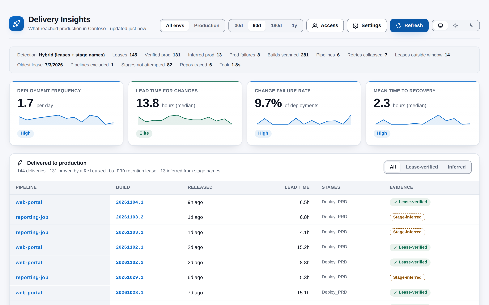
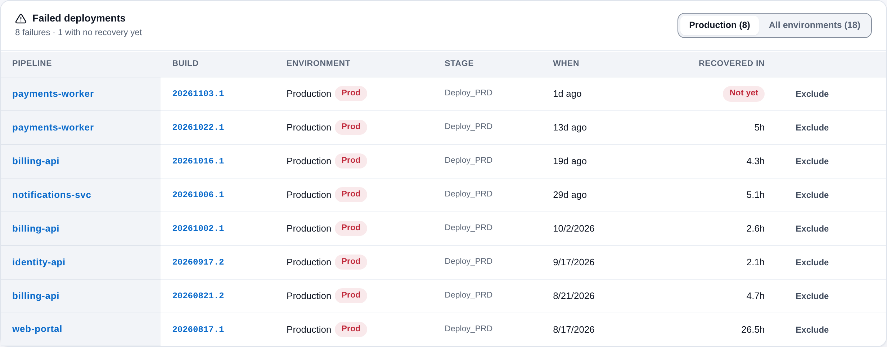

# Delivery Insights

See what actually reached production, what failed on the way, and how your DORA metrics are trending, without any data leaving your Azure DevOps organization. Delivery Insights is built for engineering leads and platform teams who want an honest answer to "how are we delivering?". It lives under **Pipelines > Delivery Insights** and runs entirely in your browser.

## Production deliveries, proven rather than guessed

Most DORA tools infer "this went to production" from a pipeline stage name. Delivery Insights reads **build retention leases** instead. When your pipeline finishes deploying to production it writes a lease tagged with a well-known owner id; that lease is durable, first-party evidence that a specific build was released.

Stage names remain as a fallback, and every row says which of the two proved it: **Lease-verified** or **Stage-inferred**. Because the lease step only runs after a *successful* deployment, production **failures** still come from build timeline stage results. The two signals are reconciled per build, with guards so a retried stage, or a build that deploys to several regions, is counted once.

## Features

- **Delivered to production** - One row per delivery: release time, lead time, contributing stages and the evidence behind it. Filter to lease-verified or stage-inferred.
- **Failed deployments** - Outright failures *and* deliveries that failed an attempt before succeeding, with time to recovery per pipeline and environment. Exclude a noisy pipeline in one click.
- **DORA scorecard** - Deployment Frequency, Lead Time for Changes, Change Failure Rate and Mean Time to Recovery, with Elite/High/Medium/Low bands you can tune and a weekly sparkline on every card.
- **Commit to production** - A measured split of where the time goes: waiting for a build, build and approvals, and the deployment itself.
- **Branch journey** - Where the wait before a build actually went: writing and review, sitting on `develop`, then waiting on the build branch. Handles squash and rebase merges, and reports repositories with no integration branch as genuinely having no such hop rather than a zero.
- **Diagnostics strip** - Detection mode, lease count, verified vs inferred split, retries collapsed, and the caveats that apply to your data.
- **Environment matrix and timeline** - Latest deployment per pipeline per environment, and every deployment across environment lanes, with status shown by glyph as well as colour.
- **Weekly trends** - Four trend charts with screen-reader data tables.
- **Stop any time** - Long scans can be stopped, and the last analysis is kept on screen until you choose to re-analyse.
- **Access list** - The first person to claim the dashboard becomes its administrator and grants access to teammates by email address.
- **Follows your Azure DevOps theme** - Light, dark and high contrast, with a manual light/dark override and WCAG AA contrast.

## How it works

1. Add the retention-lease step (documented in the project's README) to the end of your production deployment job.
2. Open **Pipelines → Delivery Insights** and claim ownership.
3. Grant access to your team, and confirm in Settings that the lease owner id matches what your pipeline writes.
4. Click **Analyse**.

Without step 1 the extension still works: it falls back to stage-name detection and marks production rows as stage-inferred.

## A note on access control

The access list controls who sees this dashboard. It is **not a security boundary**: anyone who can read builds in the project can read the same data directly from the Azure DevOps REST API, and the list itself is stored in extension data that any user of this extension can modify through the API. It keeps a dashboard scoped to the right audience; it does not restrict access to the underlying data.

## Permissions

- **Build (read)** - Pipelines, builds, stage timelines, the commits in each build, and retention leases.
- **Code (read)** - Commit dates for lead time, and completed pull requests and branch names for the branch journey.
- **Extension data** - Saves your settings, the access list, the last analysis and your theme choice.
- **Project** - Requested for the current project context.

No additional permissions are needed for access control.

## Privacy

Everything runs in your browser and talks only to your own Azure DevOps organization. There is no telemetry and nothing is sent to any third party. Settings, the access list and the last analysis are stored in the Azure DevOps Extension Data Service, separately for each project; your theme choice is stored for you alone.

## Support

Bug reports and feature requests are welcome through GitHub Issues: <https://github.com/adam-wheater/azure-devops-delivery-insights/issues>

## License

Copyright © 2026 Adam Wheater. All rights reserved. This software is provided under a proprietary source-available license: you may read and audit the code and use the published extension, but you may not copy, modify, redistribute or republish it. See the LICENSE file for the full terms. The open source components it bundles keep their own licenses, listed in THIRD-PARTY-NOTICES.txt inside the package.
